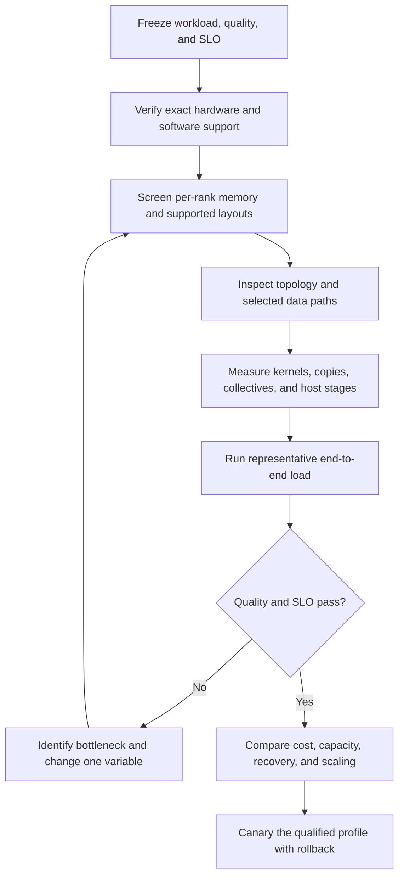

# AWS GPU Flexibility Guide

**Qualify the whole GPU workload: kernels, memory, interconnect, host pipeline, network, storage, quality, cost, and recovery.**

A practical guide for teams moving between AWS G7e, H100, H200, B200, and B300 capacity. It combines a sourced instance catalog, bottleneck-oriented portability guidance, sharding and memory arithmetic, a target-hardware validation runbook, and offline analytical tools.

> **Unofficial and independent.** This project is not an AWS or NVIDIA publication and is not endorsed by either company. Sources were reviewed on **2026-10-11**. Hardware availability, software support, and commercial terms change. No GPU benchmarks, customer-account capacity checks, or model-load tests were performed for this guide.

## Start here

| Your question | Read |
|---|---|
| “What in an existing codebase needs migration review?” | [Local read-only codebase assessor](CODEBASE_ASSESSMENT.md) |
| “What do published measurements actually establish?” | [Ten scoped studies and source audits](docs/11-published-evidence.md) |
| “Can we explore tradeoffs without renting GPUs?” | [CPU-only analytical sensitivity lab](SIMULATION.md) |
| “Where could a migration introduce a hidden bottleneck?” | [Whole-workload portability](docs/09-workload-portability.md) |
| “How do I prove the application uses P2P, NCCL, or EFA?” | [Target-hardware validation runbook](docs/10-validation-runbook.md) |
| “What should I try when G7e capacity is unavailable?” | [Decision guide](docs/01-decision-guide.md) |
| “Which AWS instance actually has this GPU?” | [Instance catalog and size traps](docs/02-instance-catalog.md) |
| “Will the weights, context, and concurrency fit?” | [Memory accounting](docs/03-model-memory.md), then [worked examples](docs/06-worked-examples.md) |
| “Should I use TP, PP, replicas, or training-state sharding?” | [Parallelism and topology](docs/04-parallelism.md) |
| “How do we qualify and roll back a migration?” | [Migration playbook](docs/05-migration-playbook.md) |
| “How do we compare performance and cost fairly?” | [Benchmark protocol](docs/07-benchmarking.md) and [plan template](templates/benchmark-plan.md) |
| “How does the calculator work?” | [Estimator reference](docs/08-estimator-reference.md) |

Start with the workload’s critical path: what runs on the GPU, what moves between GPUs or hosts, and what waits on CPU, network, or storage. Memory feasibility is one gate in that workflow.

For platform and ML engineers, the full guide is a qualification workflow. For customer-facing architects, start with the decision guide and use the examples to explain assumptions rather than promise model fit.

## Three facts that prevent expensive mistakes

1. **G7e uses RTX PRO 6000 Blackwell Server Edition, with nominal 96 GB GDDR7 per GPU and PCIe GPUDirect P2P.** It is a different platform from the NVLink/NVSwitch-connected eight-GPU P families. [AWS G7e](https://aws.amazon.com/ec2/instance-types/g7e/)
2. **P5 is H100; P5e/P5en are H200; P6-B200 and P6-B300 are B200 and B300.** A single-GPU H100 P5 has less nominal per-device memory than G7e. B300 is an existing EC2 offering, not merely a roadmap placeholder. [AWS P5](https://aws.amazon.com/ec2/instance-types/p5/), [AWS P6](https://aws.amazon.com/ec2/instance-types/p6/)
3. **Aggregate GPU memory is not one allocation pool.** A model needs an explicit supported sharding strategy, and every rank must remain below its own peak memory budget. A model that loads still needs quality, latency, capacity, and recovery validation.

## The decision in one picture



Text equivalent: establish the workload → verify compatibility and memory → prove the actual data paths → measure component and end-to-end behavior → compare useful work, cost and recovery → canary with rollback. [Detailed runbook](docs/10-validation-runbook.md)

## Five-minute offline quickstart

Requirements: Python **3.10 or newer**. Run from the repository root. No packages, AWS credentials, network calls, GPU, or model download are required.

```bash
python3 -m unittest discover -s tests -v
python3 -m gpu_fit --help
```

Screen an illustrative 8B GQA model at eight resident 8,192-token sequences:

<!-- smoke-test: inference_8b -->
```bash
python3 -m gpu_fit inference \
  --parameters 8e9 --gpu-memory-gib 80 \
  --layers 32 --query-heads 32 --kv-heads 8 --head-dim 128 \
  --context-tokens 8192 --concurrency 8 \
  --runtime-overhead-gib 2
```

Expected arithmetic: **24.90 GiB per GPU**, against a **68.00 GiB** budget after the default 15% reserve. The 80 GiB capacity and 2 GiB runtime allowance are scenario inputs, not measured instance specifications or a recommended universal reserve. The output includes assumptions and warnings. Add `--json` for all inputs and component values.

**A `within_budget_screen` result is permission to investigate, not proof of fit.** The estimator does not load a checkpoint, know actual kernel support, predict latency, or discover available AWS capacity. Its training mode is a persistent-state lower-bound calculation. [Limits and input definitions](docs/08-estimator-reference.md)

## Explore performance tradeoffs without GPUs

The separate [analytical sensitivity lab](SIMULATION.md) evaluates 96 hypothetical scenarios for prefill/decode, batch and context, TP/PP, peer/network paths, overlap, replicas, and training synchronization:

```bash
python3 simulation.py --only decode_tp8_network --json
```

Its outputs decompose local compute/memory work and communication under explicit assumptions. They are **uncalibrated simulations, not GPU emulation, measurements, or a ranking of AWS instances**. The [published-evidence review](docs/11-published-evidence.md) keeps measured studies separate and explains why a reported gain may not transfer. No controlled direct G7e-to-AWS H100/H200/B200/B300 portability comparison was established in that selected review.

## Assess an existing codebase locally

The [read-only assessor](CODEBASE_ASSESSMENT.md) turns selected source/configuration signals into review suggestions and a required target-hardware test plan. Try the synthetic example from this trusted guide checkout:

```bash
python3 -B -m gpu_assess examples/codebase-fixture \
  --source-instance g7e.48xlarge --target-instance p5.48xlarge \
  --workload serving
```

It requires Python 3.10+ on Linux/macOS with POSIX no-follow support. It does not import or execute customer code, install dependencies, contact a service, edit the checkout, or certify portability. Findings are lexical hints with bounded coverage; absence of a match is not an all-clear. The committed fixture and reports are synthetic. Read the [privacy, traversal, and interpreter-environment limits](CODEBASE_ASSESSMENT.md) before scanning an authorized customer checkout.

## What is included

- A [local static codebase assessor](CODEBASE_ASSESSMENT.md) with synthetic examples, read-only/privacy safeguards, and target-specific review prompts
- [Decision and portability chapters](docs/01-decision-guide.md), with primary-source links beside claims
- [Ten scoped published studies](docs/11-published-evidence.md), including a corrected G7e practitioner result and explicit evidence gaps
- A [96-scenario CPU analytical lab](SIMULATION.md) with reproducible inputs/results and tests
- A [hardware-to-application diagnostic runbook](docs/10-validation-runbook.md) for topology, peer transfers, collectives, and end-to-end validation
- [31-size machine-readable inventory](data/instance-catalog.json), preserving source units and uncertainties
- Standard-library-only [Python estimator](gpu_fit/model.py) for dense decoder inference and full-parameter training-state arithmetic
- Tests for formulas, validation, unit conversions, partitioning, documented commands, and local links
- Empty [benchmark results CSV](templates/benchmark-results.csv) and a reviewable [qualification plan](templates/benchmark-plan.md)
- [Source ledger and refresh policy](docs/SOURCES.md) and [validation record](VALIDATION.md)

The guide focuses on NVIDIA GPU alternatives. Trainium/Inferentia require a different software-porting assessment. Grace-based P6e UltraServers are discussed separately because their host architecture and deployment shape change the migration scope.

## Maintenance and licensing

For corrections, cite the exact source and instance/engine version, preserve GB/GiB distinctions, and rerun the offline tests. Keep actual benchmark evidence separate from illustrative arithmetic. Do not commit credentials or customer data. See [CONTRIBUTING.md](CONTRIBUTING.md).

A license has not yet been selected; no `LICENSE` file is included. AWS, Amazon EC2, NVIDIA, and product names remain the trademarks of their respective owners.
